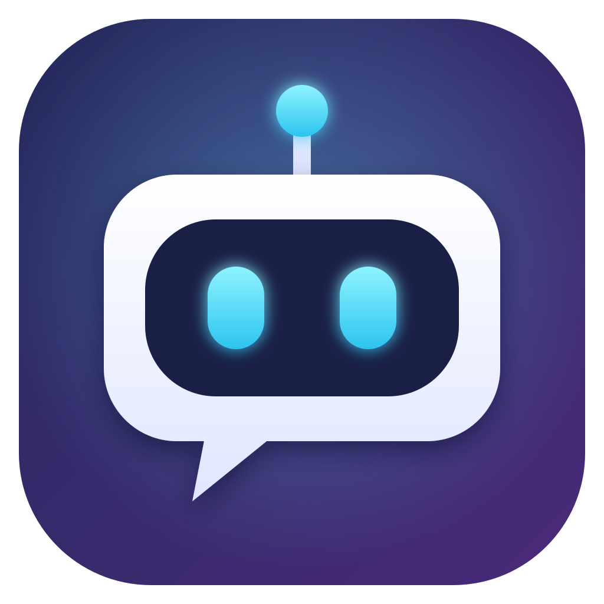

<p align="center"></p>

# Deskroid

[English](README.md) | 日本語

Deskroid（デスクロイド）は、デスクトップに常駐して話せるキャラクターのアプリです。好きなキャラクター（Live2D または 3D）が画面の隅にいて、文字でも声でも話しかけられます。
会話・音声認識・読み上げはすべてローカルで動くので、クラウドの API キーや利用料は要りません。

> 日本語と**英語**に対応しています。ふだんは OS の言語に合わせて切り替わり、右クリック →「言語 / Language」からも選べます。

<p align="center">
  <a href="https://github.com/mkosei/deskroid/releases/latest/download/Deskroid-Setup.exe"></a>
  <a href="https://github.com/mkosei/deskroid/releases/latest/download/Deskroid-arm64.dmg"></a>
  <a href="https://github.com/mkosei/deskroid/releases/latest/download/Deskroid-x64.dmg"></a>
</p>


- 会話: [Ollama](https://ollama.com/)（既定は `qwen3:8b`）
- 表示: Electron + Live2D（Cubism 3/4）／ 3D（glTF・GLB・VRM、three.js + [three-vrm](https://github.com/pixiv/three-vrm)）
- 読み上げ: 日本語は [VOICEVOX](https://voicevox.hiroshiba.jp/)、英語は [Kokoro](https://huggingface.co/hexgrad/Kokoro-82M)（[kokoro-js](https://github.com/hexgrad/kokoro)）
- 音声認識: Whisper（[transformers.js](https://github.com/huggingface/transformers.js)、`whisper-large-v3-turbo`）

## できること

- 吹き出しでの会話（返事の気持ちに合わせて表情や動きが変わる）
- 声での会話（マイク → 文字起こし → 返事を読み上げ、口パク）
- 「電卓開いて」「ディスコード起動して」など、パソコンに入っているアプリを名前で開く（アプリの一覧はそのパソコンから自動で集めるので、設定は要らない）
- YouTube のチャンネル・動画や、プライムビデオの作品を、名前を言うだけで直接開く（「YouTube でヒカキン開いて」「lofi 流して」「プライムビデオでハンターハンター見たい」など。いちばん上の結果を調べて、いつものブラウザでそのページを開く）
- サイトを開く・サイトの中で探す・Web で調べる・フォルダを開く（「アマゾンでワイヤレスイヤホン探して」「カルボナーラの作り方調べて」「ダウンロードフォルダ開いて」など）
- 「明日の天気は？」で天気予報を答える
- 音量・再生の操作（「ちょっと音量下げて」「音楽止めて」「次の曲にして」など）
- タイマー・リマインダー（「3分後にカップラーメンできたって教えて」「7時半に起こして」など。時間になるとキャラが吹き出しと声で知らせる。アプリを終了するとタイマーは消える）
- 時計とポモドーロ（キャラの右下に時計を表示。「ポモドーロ始めて」「50分集中・10分休憩で」と頼むと、集中と休憩をくり返し、区切りごとにキャラが声をかける。残り時間は時計の輪っかで見られ、マウスを乗せると、ポモドーロ・タイマー（1分〜1時間から選ぶ）・一時停止・スキップ・停止のボタンが出る。「タイマーあと何分？」にも答える）
- コピーした文章を扱う（「コピーした文章、要約して」「これ英語にして」「このエラーどういう意味？」など。クリップボードは頼まれたときだけ読み、「クリップボードに入れて」と言われたときだけ書き換える）
- 一度に複数の頼みや、結果しだいの頼みもこなす（「YouTube 開いて音量上げて」「明日雨だったら朝7時に傘のこと教えて」など）
- 好きなモデルの読み込み（Live2D・3D）とキャラの切り替え
- 3D モデルはボーンを自動で見つけて、視線・呼吸・手を振る・立ち姿・足の組み替えなどを付ける
- VRM モデルは、まばたき・表情（笑顔・怒り・悲しみ・驚き）・口パク・視線・髪や服の揺れも動く
- 日本語と英語：メニュー・設定画面・返事・音声認識・声がまとめて切り替わる

## 同梱キャラクター

最初から 4 人のキャラが入っていて、右クリック →「キャラ切り替え」で選べます。

| キャラ | 見た目 | 話し方 | 声（VOICEVOX） | 英語の声（Kokoro） |
|---|---|---|---|---|
| ヴィータ（最初はこの子） | 青いメッシュの入った銀髪、オッドアイ | クールだけど面倒見がいい、気さくなタメ口 | 冥鳴ひまり | `af_sky` |
| ヴィクトリア | ふわっとした金髪、ピンクのドレス | おっとりしたお嬢様、やわらかい丁寧語 | 四国めたん（あまあま） | `bf_emma` |
| サンプルA | 茶色のボブ、カーディガン | 落ち着いた聞き上手、やわらかいタメ口 | 春日部つむぎ | `af_heart` |
| 千駄ヶ谷 篠 | 黒髪ロング、制服 | しっかり者の生徒会長、落ち着いた丁寧語 | 九州そら | `bf_isabella` |

モデルはどれも [VRoid プロジェクト](https://vroid.com/) のサンプルモデルで、VRoid Hub の利用条件（再配布・改変・商用利用 OK、クレジット不要）に従って同梱しています。
アプリ本体の MIT ライセンスとは別の条件です。詳しくは [assets/avatars/LICENSE.md](assets/avatars/LICENSE.md) を見てください。

## 必要なもの

- Windows 10 / 11、または macOS（Apple シリコン・Intel）
- [Ollama](https://ollama.com/) と会話用モデル（初回セットアップの「Ollama を入れる」「まとめて準備する」で、アプリが公式の配布元から入れます）
- [VOICEVOX](https://voicevox.hiroshiba.jp/)（日本語の声で話させたいときだけ。セットアップの「声を入れる」を押すと、アプリが公式の配布元からエンジンをダウンロードします（約 2GB）。VOICEVOX 本体を入れてある場合は、そちらを使います）
- 英語の声は追加のソフト不要です（初めて話すときに Kokoro の音声モデル 約 90MB を自動でダウンロードします）
- メモリ 8GB 以上。メモリ 16GB 以上か、VRAM 6GB 以上の GPU（NVIDIA・AMD）、または Apple シリコンの Mac があると快適です。セットアップの画面で、この PC の性能と、それに合う会話モデルを教えてくれます

## インストール

<p align="center">
  <a href="https://github.com/mkosei/deskroid/releases/latest/download/Deskroid-Setup.exe"></a>
  <a href="https://github.com/mkosei/deskroid/releases/latest/download/Deskroid-arm64.dmg"></a>
  <a href="https://github.com/mkosei/deskroid/releases/latest/download/Deskroid-x64.dmg"></a>
</p>

ボタンからは、いつでも最新版がダウンロードされます。前のバージョンや更新内容は [Releases](https://github.com/mkosei/deskroid/releases) にあります。

| OS | ファイル |
|---|---|
| Windows | `Deskroid-Setup.exe` |
| Mac（Apple シリコン：M1 以降） | `Deskroid-arm64.dmg` |
| Mac（Intel） | `Deskroid-x64.dmg` |

- **Windows**：ダブルクリックしてインストールします。「Windows によって PC が保護されました」と出たら、「詳細情報」→「実行」を押してください（署名をしていないアプリのため）。
  デスクトップとスタートメニューに「Deskroid」ができます
- **Mac**：dmg を開いて、アプリを「アプリケーション」フォルダへドラッグします。
  署名をしていないアプリなので、初回は Finder でアプリを右クリック →「開く」を選んでください。
  それでも開けないときは、ターミナルで次を実行します

```bash
xattr -dr com.apple.quarantine /Applications/Deskroid.app
```

### 更新

起動の少しあとと、その後 1 日ごとに、新しい版が出ていないか調べます。

- **Windows**：新しい版を裏でダウンロードしておき、アプリを終了するときに入れ替えます。すぐ更新したいときは、右クリック →「再起動して Deskroid を更新する」
- **Mac**：新しい版が出たらキャラが知らせます。右クリック →「Deskroid の新しい版をダウンロード」から入れ直してください（署名をしていないため、自動では入れ替えられません）
- **VOICEVOX**：セットアップの「声を入れる」で入れたエンジンに新しい版が出たら、右クリックメニューとセットアップに出ます。「更新する」で入れ替えます（約 2GB）

### 初回セットアップ

初めて起動すると「セットアップ」の画面が出て、必要なものがそろっているか確認します。足りないものはボタンから準備できます。
足りないものが 2 つ以上あるときは「まとめて準備する」で、上から順に全部準備できます（声や音声認識など、いらないものはチェックを外せます）。

| 項目 | 内容 |
|---|---|
| この PC の性能 | メモリ・GPU・ディスクの空きを調べて、会話する AI が快適に動きそうか、どのモデルがおすすめかを出します |
| Ollama | 入っていなければ「Ollama を入れる」で、公式の配布元からダウンロードして入れます（Windows は約 1.7GB、Mac は約 0.2GB）。入っていて止まっていれば起動します |
| 会話モデル | 入っていなければ、この PC に合うモデル（`qwen3:8b` 約 5.2GB / `qwen3:4b` 約 2.5GB / `qwen3:1.7b` 約 1.4GB / `qwen3:0.6b` 約 0.5GB）を選んでダウンロードできます。入っているモデルがこの PC には重そうなときは、軽いモデルに変えられます |
| VOICEVOX（任意） | 日本語のとき。声で話させるときに使います。入っていなければ「声を入れる」で、エンジン（全部の声）をダウンロードして使えるようにします |
| 英語の声（Kokoro・任意） | 英語のとき。初めて話すときに自動でダウンロードされます（約 90MB）。「今すぐ準備する」で先に用意もできます |
| マイク | Mac では、ここでマイクの使用を許可します |
| 音声認識モデル（任意） | 声で話しかけるときに使います（約 1GB）。初めて声で話しかけたときにも自動で準備されます |

そろったら「はじめる」を押すとキャラが出てきます。あとから右クリック →「セットアップ」でいつでも開けます。
Ollama につながらないときも、起動時に自動でこの画面が出ます。

## ソースから動かす（開発する人向け）

[Node.js](https://nodejs.org/) LTS が必要です。

```bash
git clone https://github.com/mkosei/deskroid.git
```
```bash
cd deskroid
```
```bash
npm install
```
```bash
npm start
```

Windows なら `start.bat` をダブルクリックしても起動できます。

`npm install` のあと `node_modules/electron/dist` に Electron 本体が無い場合は、npm がインストールスクリプトを止めています。
npm の表示に従って Electron のスクリプトを許可し、入れ直してください。

```bash
npm install-scripts approve electron
```
```bash
npm rebuild electron
```

### インストーラーを作る

```bash
npm run dist
```

`dist/` にインストーラーができます（Windows では `.exe`、Mac では `.dmg`）。Mac 用は Mac の上でしか作れません。
`v0.2.0` のようなタグを push すると、GitHub Actions が Windows と Mac の両方のインストーラーを作って Releases に置きます。

## 使い方

| 操作 | 内容 |
|---|---|
| キャラを左クリック | 入力欄を出す／しまう（反応して動く） |
| キャラをドラッグ | 好きな場所へ移動 |
| キャラを右クリック | メニュー（下の表） |
| `Ctrl+Space`（Mac は `Option+Space`） | 1 回だけ声を聞いて返事をする。話し終わって 3 秒黙ると送る。もう一度押す（または送信ボタン）とすぐ送る。話し始める前にもう一度押すと取り消し |
| `Ctrl+Alt+V`（Mac は `Command+Option+V`）/ マイクボタン | 音声会話モードの ON/OFF（話し終わるたびに自動でまた聞く）。3 秒黙るか、送信ボタンを押すと送る |

ホットキーは、右クリック →「ホットキー設定…」で好きなキーに変えられます（下を参照）。

右クリックメニュー：

| 項目 | 内容 |
|---|---|
| キャラ切り替え | 登録してあるキャラを切り替える |
| 立ち姿 / 足 | 3D キャラのポーズ（手を後ろで組む・自然体・腰に手・足を組む・おまかせ） |
| 会話をリセット | 会話の履歴を消す |
| 声 | VOICEVOX の声（キャラと話し方）を選ぶ。キャラごとに覚えておく（日本語で、VOICEVOX が動いているとき） |
| タイマー | 1 分〜1 時間のタイマーをセットする・全部取り消す |
| ポモドーロ | ポモドーロを始める・一時停止・次へ進む・やめる。集中・休憩・長めの休憩の時間と、長めの休憩までの回数も選べる |
| 時計 | 時計を出すか（ポモドーロやタイマーの残り時間は、オフでも出る）、キャラの右と左のどちらに出すか |
| 常に最前面 | ほかのウィンドウより前に出しておくか |
| パソコンの起動時に開く | Windows・Mac にサインインしたときに、Deskroid を自動で起動する |
| モデルを読み込む… | 好きなモデルを追加する（下で説明） |
| キャラ設定を開く | `config.local.json` を開く |
| 配色設定… | 吹き出しや入力欄の色を変える。背景・文字・強調色・名札の色を選ぶと、キャラの画面にすぐ反映されます。「キャラの見た目から自動で作る」もできます |
| ホットキー設定… | ホットキーを変える。「変更」を押してから使いたいキーを押すと登録され、保存するとすぐ使えます。「なしにする」で使わないこともできます |
| セットアップ | セットアップの画面をもう一度開く |
| AI のモデル | **会話**：Ollama に入っているモデルから選ぶ（次の返事から使う）。軽いモデルを使うときは、セットアップの「会話モデル」で選んで入れるか、`ollama pull qwen3:4b`（約 2.5GB）のように入れておく。**音声認識**：高精度（メモリ約 1.9GB）か軽量（約 0.7GB・聞き間違いが増える）。パソコンのメモリが足りず音声認識を読み込めないときは、軽量にする |
| 言語 / Language | 自動（OS に合わせる）・日本語・English。選ぶと画面がその言語で開き直します |
| 設定を再読み込み | 設定ファイルの変更を反映する |

話しかけ方の例：

- 「電卓開いて」「ディスコード起動して」「エクセル使いたい」
- 「ちょっと音量下げて」「音楽止めて」「5分後にストレッチするように言って」「7時半に起こして」
- 「YouTube 開いて音量上げて」「明日雨だったら朝7時に傘持っていくように言って」
- （文章をコピーしてから）「これ要約して」「これ英語にしてクリップボードに入れて」「このエラーどういう意味？」
- 「YouTube 開いて」「ユーチューブで猫の動画探して」「カルボナーラの作り方調べて」「ダウンロードフォルダ開いて」
- 「今日の天気は？」「明日千葉って雨降る？」

## モデルを読み込む

右クリック →「モデルを読み込む…」で、次のファイルを選びます。

| 種類 | 選ぶファイル | 備考 |
|---|---|---|
| Live2D | `*.model3.json` | Cubism 3/4 形式。同じフォルダの中身ごとコピーされます |
| 3D | `*.vrm` / `*.glb` | 1 ファイルのままコピーされます |
| 3D | `*.gltf` | テクスチャなどを参照するので、フォルダごとコピーされます |

選んだモデルはデータフォルダ（下の「設定ファイル」を参照）の `models/<名前>/` にコピーされ、キャラとして追加されて、そのキャラに切り替わります。

自動でやってくれること：

- **Live2D**：表情の名前（Smile・Angry・Sad など）とタップ用モーション（Tap など）を名前から探して、感情や反応に割り当てます
- **3D**：首・頭・目・胸・腕・手・指・脚のボーンを名前から探します（VRM・Mixamo・3ds Max Biped・Unity・Blender などの名前に対応）。
  ボーンが見つかれば、視線・呼吸・手を振る・うなずく・立ち姿・足を組むなどが動きます。
  ボーンの無いモデルは、全体を揺らしたり跳ねさせたりする簡単な動きになります
- **VRM**：規格で決まっているボーン・表情を使うので、名前を推測しなくても確実に動きます。
  まばたき・表情・口パク・視線・髪や服の揺れも付きます。VRM 0.x の後ろ向きのモデルはこちらを向くように回します

### 読み込んだキャラを調整する

右クリック →「キャラ設定を開く」で `config.local.json` を開き、`characters` の中の項目を書き換えて「設定を再読み込み」します。

| 項目 | 内容 |
|---|---|
| `characterName` / `characterName_en` | 名前（吹き出しに出る）。`_en` は英語のときに使う |
| `persona` / `persona_en` | 性格・話し方（AI への指示文）。`_en` は英語のときに使う |
| `modelScale` | Live2D の大きさ |
| `expressions` | 感情タグ（normal / smile / angry / sad / surprised / shy）→ 表情。Live2D は表情名、または `{ "パラメータID": 値 }` |
| `tapMotions` | Live2D で頭・体をクリックしたときのモーショングループ |
| `theme` | UI の配色（例：`{ "accent": "#c8435a", "panel": "rgba(28,27,45,0.92)" }`）。書かなければ、キャラの見た目から自動で作ります。ふだんは「配色設定…」から変えるのが簡単です |
| `voice` | 声の設定（`{ "enabled": false }` で声なし、`speaker` で VOICEVOX の話者 ID、`enVoice` で英語の声。女性は `af_heart`・`bf_emma` など、男性は `am_adam`・`bm_george` など） |
| `model3d.fill` | 3D キャラが画面の高さのどれくらいを占めるか（0.8 = 8 割） |
| `model3d.rotationY` | 3D キャラの向き（ラジアン。後ろを向いてしまうときは `3.14159`） |
| `model3d.hideMeshes` | 消したい部品の名前（マテリアル名かメッシュ名の一部）。武器などを消すときに |
| `model3d.motionScale` / `motionSpeed` | 動きの大きさ・速さ |
| `model3d.fingerCurl` | 指の曲げ具合（0 でまっすぐ） |

## 設定ファイル

- `config.json`：共通の設定（会話モデル、ホットキー、開けるサイト、天気の地域、音声認識など）。アプリに同梱されています
- `config.local.json`：この PC だけの設定（読み込んだキャラ、選択中のキャラ、セットアップ済みか）。`config.json` より優先されるので、
  共通の設定を変えたいときも、同じ項目をここに書けば上書きできます

`config.local.json` と読み込んだモデル（`models/`）の置き場所（データフォルダ）：

| 動かし方 | 場所 |
|---|---|
| インストーラーで入れた（Windows） | `%APPDATA%\Deskroid` |
| インストーラーで入れた（Mac） | `~/Library/Application Support/Deskroid` |
| ソースから動かしている | アプリのフォルダ |

右クリック →「キャラ設定を開く」で、`config.local.json` をすぐ開けます。

主な項目：

| 項目 | 内容 |
|---|---|
| `language` | `"auto"`（OS に合わせる。既定）・`"ja"`・`"en"`。「言語 / Language」メニューで選ぶと `config.local.json` に保存されます |
| `ollamaModel` | 会話に使う Ollama のモデル（例：`qwen3:14b`） |
| `hotkeys` | `listenOnce`（1 回だけ聞く）と `voiceChat`（音声会話 ON/OFF）のキー。`{ "win": "Control+Space", "mac": "Alt+Space" }` のように OS ごとにも書けます。ふだんは「ホットキー設定…」から変えるのが簡単です（`config.local.json` に保存されます） |
| `apps` | 追加で開けるようにしたいサイト・アプリ（入っているアプリや、Google・YouTube・Amazon などよく使うサイトは書かなくても開けます）。`open` に URL かアプリのパス、`search` に `{query}` 入りの検索 URL。スタートメニューや「アプリケーション」に出てこないアプリはパスで書きます |
| `weather.places` | 天気を調べる地域（地名と緯度・経度。`name_en` で英語の地名） |
| `voice` | 声の設定。日本語は VOICEVOX の URL・話者 ID・話速など、英語は Kokoro の声（`enVoice`）と速さ（`enSpeed`） |
| `stt` | 音声認識のモデル・デバイス・精度。`silenceMs` は、話し終わってから送るまで黙って待つ時間（既定は 3000 = 3 秒）。音声認識のモデル（メモリ約 1.5GB）は話しかけ始めたときに読み込み、`unloadAfterMinutes` 分（既定は 10）使わなければメモリから外す（0 で外さない）。`preload` を true にすると起動時から読み込んでおく |

## 注意

- モデルは、それぞれの配布元のライセンス・利用規約に従って使ってください。配布や公開が禁止されているモデルも多いので、`models/` を公開リポジトリに含めないよう気をつけてください
- VOICEVOX で作った音声を公開するときは、各キャラクターの規約に従ってクレジット（例：「VOICEVOX:ずんだもん」）を表記してください
- Kokoro の音声モデルは Apache 2.0 ライセンスで公開されています

## ライセンス

- アプリ本体のソースコード：[MIT](LICENSE)
- 同梱キャラクターのモデル（`assets/avatars/`）：VRoid Hub の利用条件（[assets/avatars/LICENSE.md](assets/avatars/LICENSE.md)）
