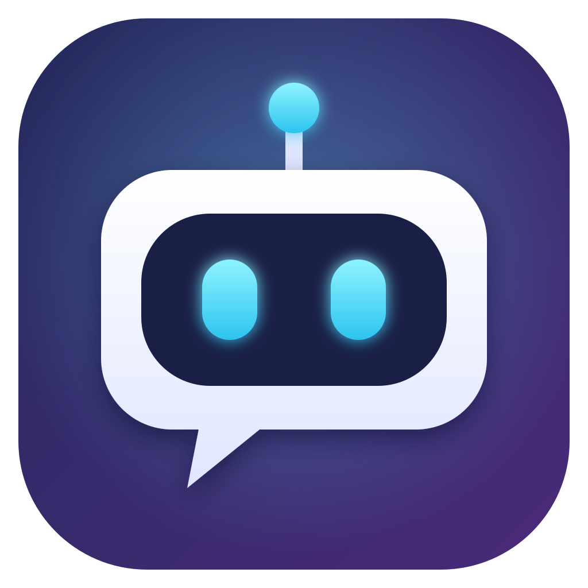
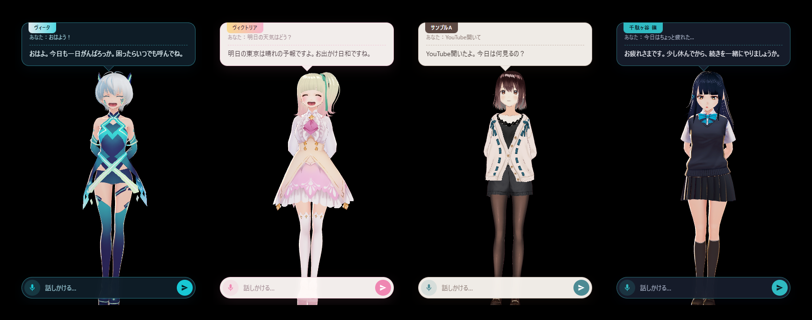

<p align="center"></p>

# Deskroid

English | [日本語](README.ja.md)

Deskroid is a talking character that lives on your desktop. Your favorite character (Live2D or 3D) sits in the corner of the screen, and you can talk to it by text or by voice.
Chat, speech recognition and text-to-speech all run locally, so there are no cloud API keys or usage fees.

> The app works in **English** and **Japanese**. It follows your OS language by default, and you can switch from the right-click menu → "Language / 言語".

<p align="center">
  <a href="https://github.com/mkosei/deskroid/releases/latest/download/Deskroid-Setup.exe"></a>
  <a href="https://github.com/mkosei/deskroid/releases/latest/download/Deskroid-arm64.dmg"></a>
  <a href="https://github.com/mkosei/deskroid/releases/latest/download/Deskroid-x64.dmg"></a>
</p>



- Chat: [Ollama](https://ollama.com/) (default model: `qwen3:8b`)
- Rendering: Electron + Live2D (Cubism 3/4) / 3D (glTF, GLB, VRM via three.js + [three-vrm](https://github.com/pixiv/three-vrm))
- Text-to-speech: [Kokoro](https://huggingface.co/hexgrad/Kokoro-82M) for English ([kokoro-js](https://github.com/hexgrad/kokoro)), [VOICEVOX](https://voicevox.hiroshiba.jp/) for Japanese
- Speech recognition: Whisper ([transformers.js](https://github.com/huggingface/transformers.js), `whisper-large-v3-turbo`)

## Features

- Chat in speech bubbles (expressions and gestures change with the mood of each reply)
- Voice conversation (microphone → transcription → spoken reply with lip sync)
- Open apps installed on your PC just by naming them, e.g. "open the calculator" or "launch Discord" (the app list is read from your PC, so no setup is needed)
- Open a YouTube channel or video, or a Prime Video title, directly by name, e.g. "open HikakinTV on YouTube", "play lofi", "I want to watch Hunter x Hunter on Prime Video" (it looks up the top result and opens that page in your usual browser)
- Open websites, search inside them, search the web, and open folders, e.g. "find wireless earbuds on Amazon", "look up how to make carbonara", "open my Downloads folder"
- Ask for the weather forecast, e.g. "what's the weather tomorrow?"
- Control the volume and playback, e.g. "turn the volume up a little", "pause the music", "next track"
- Timers and reminders, e.g. "tell me in 3 minutes that my noodles are ready", "wake me up at 7:30" (the character tells you by speech bubble and voice; timers are cleared when the app quits)
- Clock and pomodoro: a small clock sits next to the character. Say "start a pomodoro" or "50 minutes focus, 10 minutes break" and it repeats focus and breaks, with the character speaking up at each switch. A ring shows the time left, and hovering shows buttons for the pomodoro, a timer (pick 1 minute to 1 hour), pause, skip and stop. It also answers "how long is left on the timer?"
- Work with text you copied, e.g. "summarize what I copied", "translate this into Japanese", "what does this error mean?" (the clipboard is only read when you ask, and only changed when you say "put it on the clipboard")
- Several requests at once, and requests that depend on a result, e.g. "open YouTube and turn the volume up", "if it rains tomorrow, remind me at 7 am to take an umbrella"
- Import your own models (Live2D / 3D) and switch between characters
- 3D models: bones are detected automatically to add eye contact, breathing, waving, standing poses and leg crossing
- VRM models also blink, change facial expressions (happy, angry, sad, surprised), lip-sync, follow the cursor with their eyes, and have hair/clothes physics
- English and Japanese: menus, settings screens, replies, speech recognition and voices all switch together

## Bundled characters

Four characters are included out of the box. Switch between them from the right-click menu → "Switch character".

| Character | Look | Personality / speech | English voice (Kokoro) | Japanese voice (VOICEVOX) |
|---|---|---|---|---|
| Vita (default) | Silver hair with blue streaks, heterochromia | Cool but caring, casual | `af_sky` | Meimei Himari |
| Victoria | Fluffy blond hair, pink dress | Easygoing young lady, soft polite speech | `bf_emma` | Shikoku Metan (sweet) |
| Sample A | Brown bob, cardigan | Calm, a good listener, casual | `af_heart` | Kasukabe Tsumugi |
| Shino Sendagaya | Long black hair, school uniform | Dependable student council president, calm polite speech | `bf_isabella` | Kyushu Sora |

All four are sample models from the [VRoid Project](https://vroid.com/), bundled under their VRoid Hub conditions of use (redistribution, modification and commercial use allowed; no credit required).
They are licensed separately from the app's MIT license. See [assets/avatars/LICENSE.md](assets/avatars/LICENSE.md) for details.

## Requirements

- Windows 10 / 11, or macOS (Apple silicon or Intel)
- [Ollama](https://ollama.com/) and a chat model ("Install Ollama" or "Set up everything" in the first-run setup screen installs them from the official source)
- For speaking in English, nothing else is needed: the Kokoro voice model (about 90 MB) is downloaded automatically the first time
- [VOICEVOX](https://voicevox.hiroshiba.jp/) (only for speaking in Japanese; press "Install voices" in the setup screen and the app downloads the engine from the official source, about 2 GB. If you already have the VOICEVOX app, that is used instead)
- 8 GB of memory or more. 16 GB of memory, a GPU (NVIDIA or AMD) with 6 GB+ VRAM, or an Apple silicon Mac makes it comfortable. The setup screen checks this PC and tells you which chat model fits it

## Installation

<p align="center">
  <a href="https://github.com/mkosei/deskroid/releases/latest/download/Deskroid-Setup.exe"></a>
  <a href="https://github.com/mkosei/deskroid/releases/latest/download/Deskroid-arm64.dmg"></a>
  <a href="https://github.com/mkosei/deskroid/releases/latest/download/Deskroid-x64.dmg"></a>
</p>

The buttons always download the latest version. Older versions and release notes are on the [Releases](https://github.com/mkosei/deskroid/releases) page.

| OS | File |
|---|---|
| Windows | `Deskroid-Setup.exe` |
| Mac (Apple silicon: M1 or later) | `Deskroid-arm64.dmg` |
| Mac (Intel) | `Deskroid-x64.dmg` |

- **Windows**: Double-click to install. If you see "Windows protected your PC", click "More info" → "Run anyway" (the app is not code-signed).
  A "Deskroid" shortcut is added to the desktop and the Start menu
- **Mac**: Open the dmg and drag the app into the Applications folder.
  The app is not signed, so the first time, right-click it in Finder and choose "Open".
  If it still won't open, run this in Terminal:

```bash
xattr -dr com.apple.quarantine /Applications/Deskroid.app
```

### Updates

Shortly after startup, and once a day after that, the app checks for a new version.

- **Windows**: the new version is downloaded in the background and installed when you quit the app. To update right away, right-click → "Restart to update Deskroid"
- **Mac**: the character tells you when a new version is out. Right-click → "Download the new Deskroid" and install it again (the app is not signed, so it can't replace itself)
- **VOICEVOX**: if the engine installed with "Install voices" has a new version, it shows up in the right-click menu and the setup screen. "Update" replaces it (about 2 GB)

### First-run setup

On first launch, a setup screen checks that everything you need is in place. Anything missing can be set up with the buttons on that screen.
When two or more things are missing, "Set up everything" sets them all up in order (uncheck anything you don't need, such as voices or speech recognition).

| Item | What it does |
|---|---|
| This PC | Checks memory, GPU and free disk space, and shows whether the chat AI will run comfortably and which model is recommended |
| Ollama | If it isn't installed, "Install Ollama" downloads it from the official source and installs it (about 1.7 GB on Windows, about 0.2 GB on Mac). Starts it if it's installed but not running |
| Chat model | If missing, choose a model that fits this PC (`qwen3:8b` about 5.2 GB / `qwen3:4b` about 2.5 GB / `qwen3:1.7b` about 1.4 GB / `qwen3:0.6b` about 0.5 GB) and download it. If the installed model looks too heavy for this PC, you can switch to a lighter one |
| English voice (Kokoro, optional) | Shown in English mode. Downloaded automatically the first time the character speaks (about 90 MB), or press "Prepare now" |
| VOICEVOX (optional) | Shown in Japanese mode. Used for speaking Japanese. If it isn't installed, "Install voices" downloads the engine with all of its voices |
| Microphone | On Mac, grant microphone access here |
| Speech recognition model (optional) | Used when you talk by voice (about 1 GB). It is also prepared automatically the first time you speak |

When everything is ready, press "Start" and the character appears. You can reopen this screen anytime from the right-click menu → "Setup".
It also opens automatically at startup if the app can't reach Ollama.

## Running from source (for developers)

Requires [Node.js](https://nodejs.org/) LTS.

```bash
git clone https://github.com/mkosei/deskroid.git
```
```bash
cd deskroid
```
```bash
npm install
```
```bash
npm start
```

On Windows you can also double-click `start.bat`.

If the Electron binary is missing from `node_modules/electron/dist` after `npm install`, npm has blocked install scripts.
Allow Electron's scripts as npm suggests, then rebuild:

```bash
npm install-scripts approve electron
```
```bash
npm rebuild electron
```

### Building the installer

```bash
npm run dist
```

The installer is written to `dist/` (`.exe` on Windows, `.dmg` on Mac). The Mac build can only be made on a Mac.
Pushing a tag such as `v0.2.0` makes GitHub Actions build installers for both Windows and Mac and attach them to a release.

## Usage

| Action | What it does |
|---|---|
| Left-click the character | Show / hide the input box (the character reacts) |
| Drag the character | Move it anywhere |
| Right-click the character | Open the menu (see below) |
| `Ctrl+Space` (Mac: `Option+Space`) | Listen once and reply. It sends after 3 seconds of silence; press again (or the send button) to send right away. Pressing again before you start talking cancels |
| `Ctrl+Alt+V` (Mac: `Command+Option+V`) / mic button | Toggle voice conversation mode (keeps listening after each reply). Each turn is sent after 3 seconds of silence, or right away with the send button |

You can change the hotkeys from the right-click menu → "Hotkey settings…" (see below).

Right-click menu:

| Item | What it does |
|---|---|
| Switch character | Switch to another registered character |
| Standing pose / Legs | Poses for 3D characters (hands behind back, relaxed, hands on hips, legs crossed, or auto) |
| Reset conversation | Clear the conversation history |
| Voice | Pick the VOICEVOX voice (character and speaking style), remembered per character (Japanese mode, while VOICEVOX is running) |
| Timer | Set a timer from 1 minute to 1 hour, or cancel all timers |
| Pomodoro | Start, pause, skip or stop a pomodoro, and choose the focus, break and long break lengths and how often the long break comes |
| Clock | Show the clock (the pomodoro and timer countdowns show even when this is off), and put it on the right or left of the character |
| Always on top | Keep the character above other windows |
| Open when the PC starts | Start Deskroid automatically when you sign in to Windows / macOS |
| Import model… | Add your own model (see below) |
| Open character settings | Open `config.local.json` |
| Color settings… | Change the colors of the speech bubble and input box. Pick background, text, accent and name tag colors and see them applied right away. Can also generate colors automatically from the character's look |
| Hotkey settings… | Change the hotkeys. Click "Change", press the key combination you want, and save — it takes effect immediately. You can also disable a hotkey |
| Setup | Reopen the setup screen |
| AI models | **Chat**: pick from the models installed in Ollama (used from the next reply). To use a lighter one, choose it under "Chat model" in the setup screen, or install it first, e.g. `ollama pull qwen3:4b` (about 2.5GB). **Speech recognition**: Accurate (about 1.9GB of memory) or Light (about 0.7GB, more mishearing). Choose Light if speech recognition fails to load because the PC is low on memory |
| Language / 言語 | Auto (match the OS), 日本語 or English. The windows reload in the new language |
| Reload settings | Apply changes made to the settings files |

Example requests:

- "Open the calculator", "Launch Discord", "Open Excel"
- "Turn the volume up a little", "Pause the music", "Remind me in 5 minutes to check the oven", "Wake me up at 7:30"
- "Open YouTube and turn the volume up", "If it rains tomorrow, remind me at 7 am to take an umbrella"
- (after copying some text) "Summarize this", "Translate this into English and put it on the clipboard", "What does this error mean?"
- "Open YouTube", "Find cat videos on YouTube", "Look up how to make carbonara", "Open my Downloads folder"
- "What's the weather today?", "Will it rain in Chiba tomorrow?"

## Importing a model

From the right-click menu → "Import model…", choose one of the following:

| Type | File to choose | Notes |
|---|---|---|
| Live2D | `*.model3.json` | Cubism 3/4 format. The whole folder is copied |
| 3D | `*.vrm` / `*.glb` | The single file is copied |
| 3D | `*.gltf` | The whole folder is copied, since it references textures and other files |

The model is copied to `models/<name>/` in the data folder (see "Settings files" below), added as a character, and selected.

What happens automatically:

- **Live2D**: Expressions (Smile, Angry, Sad, …) and tap motions (Tap, …) are found by name and mapped to moods and reactions
- **3D**: Neck, head, eye, chest, arm, hand, finger and leg bones are found by name (VRM, Mixamo, 3ds Max Biped, Unity and Blender naming are supported).
  When bones are found, the character gets eye contact, breathing, waving, nodding, standing poses, leg crossing and more.
  Models without bones get a simpler motion that sways or bounces the whole model
- **VRM**: Uses the bones and expressions defined by the VRM standard, so everything works without guessing names.
  Blinking, facial expressions, lip sync, eye tracking and hair/clothes physics are included. VRM 0.x models that face backwards are turned around

### Tuning an imported character

Open `config.local.json` from the right-click menu → "Open character settings", edit the entries under `characters`, then choose "Reload settings".

| Key | Description |
|---|---|
| `characterName` / `characterName_en` | Name (shown on the speech bubble). `_en` is used in English mode |
| `persona` / `persona_en` | Personality and speaking style (the instructions given to the AI). `_en` is used in English mode |
| `modelScale` | Size of a Live2D model |
| `expressions` | Mood tags (normal / smile / angry / sad / surprised / shy) → expressions. For Live2D, an expression name or `{ "ParameterID": value }` |
| `tapMotions` | Live2D motion groups played when the head or body is clicked |
| `theme` | UI colors (e.g. `{ "accent": "#c8435a", "panel": "rgba(28,27,45,0.92)" }`). If omitted, colors are generated from the character's look. The "Color settings…" screen is the easiest way to change them |
| `voice` | Voice settings (`{ "enabled": false }` for no voice; `enVoice` is the Kokoro voice for English, e.g. `af_heart` or `bf_emma` for female and `am_adam` or `bm_george` for male; `speaker` is the VOICEVOX speaker ID for Japanese) |
| `model3d.fill` | How much of the window height a 3D character fills (0.8 = 80%) |
| `model3d.rotationY` | Facing direction of a 3D character in radians (use `3.14159` if it faces backwards) |
| `model3d.hideMeshes` | Parts to hide (part of a material or mesh name), e.g. to remove a weapon |
| `model3d.motionScale` / `motionSpeed` | Size and speed of the motions |
| `model3d.fingerCurl` | How much the fingers curl (0 = straight) |

## Settings files

- `config.json`: Shared settings (chat model, hotkeys, openable sites, weather locations, speech recognition, …). Bundled with the app
- `config.local.json`: Settings for this PC only (imported characters, the selected character, whether setup is done). It takes priority over `config.json`,
  so you can also override shared settings by writing the same keys here

Where `config.local.json` and imported models (`models/`) are stored (the data folder):

| How you run the app | Location |
|---|---|
| Installed (Windows) | `%APPDATA%\Deskroid` |
| Installed (Mac) | `~/Library/Application Support/Deskroid` |
| From source | The app folder |

You can open `config.local.json` directly from the right-click menu → "Open character settings".

Main keys:

| Key | Description |
|---|---|
| `language` | `"auto"` (match the OS, default), `"en"` or `"ja"`. The "Language / 言語" menu saves this to `config.local.json` |
| `ollamaModel` | The Ollama model used for chat (e.g. `qwen3:14b`) |
| `hotkeys` | Keys for `listenOnce` (listen once) and `voiceChat` (voice conversation on/off). Can be set per OS, e.g. `{ "win": "Control+Space", "mac": "Alt+Space" }`. The "Hotkey settings…" screen is the easiest way to change them (saved to `config.local.json`) |
| `apps` | Extra sites and apps the character can open (installed apps and common sites like Google, YouTube and Amazon work without this). `open` is a URL or a path to an app; `search` is a search URL containing `{query}`. Use a path for apps that are not in the Start menu / Applications folder |
| `weather.places` | Locations for weather lookups (name, latitude and longitude; `name_en` sets the English name) |
| `voice` | Voice settings: Kokoro voice (`enVoice`) and speed (`enSpeed`) for English; VOICEVOX URL, speaker ID and speaking speed for Japanese |
| `stt` | Speech recognition model, device and precision. `silenceMs` is how long to wait in silence before sending what you said (default 3000 = 3 seconds) |

## Notes

- Use models according to their distributors' licenses and terms of use. Many models may not be redistributed, so be careful not to include `models/` in a public repository
- When publishing audio generated with VOICEVOX, credit it according to each character's terms (e.g. "VOICEVOX:ずんだもん")
- The Kokoro voice model is released under the Apache 2.0 license

## License

- App source code: [MIT](LICENSE)
- Bundled character models (`assets/avatars/`): VRoid Hub conditions of use ([assets/avatars/LICENSE.md](assets/avatars/LICENSE.md))
